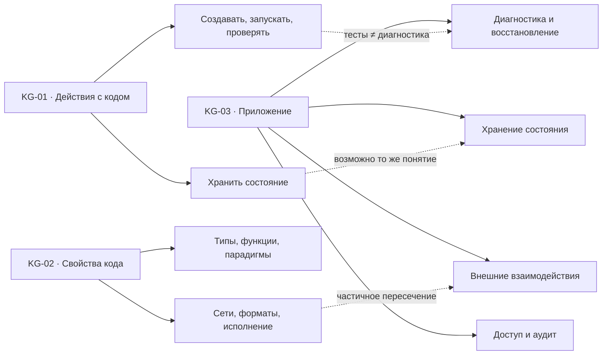

# Три карты: обзор (концептуальная модель)

**Пунктирные связи на этой схеме добавлены при интеграции; они не присутствуют на фотографиях.**

- Полные карты: [KG-01](kg01.md), [KG-02](kg02.md), [KG-03](kg03.md).
- `combined.json` — все узлы, нарисованные стрелки и отдельно помеченные педагогические связи.
- `alignments.json` — совпадающие и пересекающиеся концепты без разрушительного слияния.
